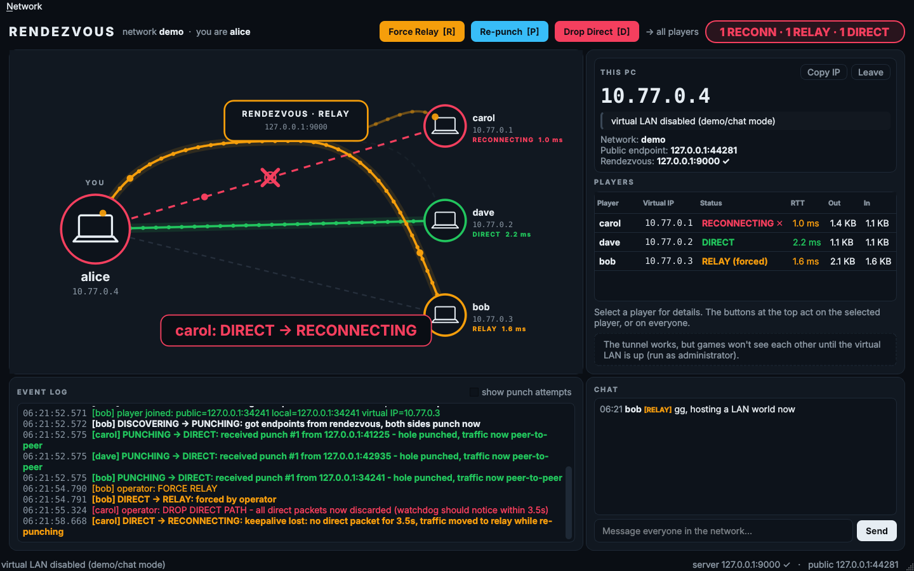

# Rendezvous: a peer-to-peer virtual LAN with a live path view

Rendezvous puts up to 8 PCs on the same virtual LAN over the internet, like
Radmin VPN or Hamachi. LAN games see each other as if the PCs were plugged
into the same switch.

- One player clicks **Host a network** and picks a network name. Their app
  runs the **rendezvous server**, opens the router port with UPnP, and shows a
  **10-digit code**. Everyone else clicks **Join a network** and types the
  network name and the code. No cloud server, account or lookup service is
  needed. A cloud server still works for networks that can't host.
- The server introduces the players and gives each one a virtual IP
  (`10.77.0.x`).
- Every pair of players tries **UDP hole punching** to get a **direct**
  connection, and falls back to **relaying through the server** if that fails.
  Each pair decides this on its own.
- A **virtual network adapter** (Wintun on Windows) carries game traffic,
  LAN broadcasts and multicast discovery through those connections.
- The app is a native Windows program (Qt), not a web page. It shows each
  connection's state live as it changes, and has buttons that force path
  changes during a demo.



```
app.py                 the desktop app (what Rendezvous.exe runs): native Qt window, Host / Join
hosting.py             hosting from the app: built-in server, UPnP port forwarding, join codes, LAN discovery
peer.py                the engine: per-player state machines, tunnel, virtual LAN routing; web dashboard for the CLI demo
vnet.py                the virtual adapter: Wintun on Windows, /dev/net/tun on Linux
dashboard.html         the web dashboard used by the command-line demo (peer.py)
rendezvous_server.py   rendezvous + relay + virtual IP assignment (stdlib only)
udp_test.py            tiny UDP echo/send tool for testing (Windows has no netcat)
run_demo.bat           one-laptop demo: server + three peers, no adapter needed
tools/                 test scripts: NAT lab, Wintun smoke test, CI end-to-end test
```

## Playing LAN games with friends

Download **Rendezvous.exe** from the latest successful
[Windows app](../../actions/workflows/windows-app.yml) build (open the run, then
the *Rendezvous-windows* artifact). Every player uses the same exe. Start it and
accept the administrator prompt: creating a network adapter needs admin rights,
as with Radmin. Windows SmartScreen may warn because the exe isn't signed; use
*More info → Run anyway*.

### Host (one player)

1. Click **Host a network**, choose a **network name** (e.g. `Friday Games`),
   enter your name, and click **Start hosting**.
2. The app starts the network on your PC and asks your router to forward its
   port (UPnP). The **Invite friends** window then shows:
   - the **network name** and a **10-digit code** like `423 122 2530`, with
     a **Copy** button;
   - whether the port was opened (✓), or what to do if it wasn't (⚠).
3. Tell your friends the name and the code. Keep Rendezvous open while you
   play: the network runs on your PC. **Stop hosting** closes it and removes
   the port forwarding.

### Join (everyone else)

1. Click **Join a network** and type the **network name** and the **code**
   (capitals and spaces don't matter), plus your name. Click **Join**.
2. Your virtual IP appears at the top right, e.g. **10.77.0.2**. Each other
   player shows up as a node and goes **PUNCHING → DIRECT** (or **RELAY**).

A mistyped name or code can't find the host; the app gives up after a few
seconds and says so. The app remembers your network and reconnects next time
(a host hosts again). **Invite friends…** shows the name and code to anyone in
the network. Closing the window leaves the network and removes the adapter.

#### How a 10-digit code can be enough

There is no lookup service behind the code: the code *is* the host's address.
An IPv4 address is a 32-bit number (at most 4,294,967,295), so it fits in 10
digits. The app scrambles it with the network name (XOR with a hash of the
name), so the code alone doesn't reveal the address, and a friend who types the
same name gets it back. The port is fixed at 9000. If the router has to use
another port, the code gets a short suffix like `:9001`. Friends in the host's
own home are found by a quick broadcast on the local network instead, since
many routers can't route back to their own public address.

The code is the host's address in disguise, not a strong password. Anyone who
knows the network name and the host's public IP could work it out. That's fine
for games with friends, but don't treat it as security.

### Play

- One player hosts a **LAN game**. The others find it in their game's LAN
  list, because broadcasts and multicast are carried across. If a game doesn't
  list it, connect directly to the host's `10.77.0.x` address.
- Anything that runs over IPv4 works, both TCP and UDP. In testing, TCP
  managed about 15 MB/s through the tunnel.

Select a player in the list (or click its node) to see its details. The
**Force Relay / Re-punch / Drop Direct** buttons (keys R / P / D) act on that
player only, or on everyone when no player is selected.

### If something doesn't work

- **The Invite friends window shows ⚠ "Couldn't open the port automatically"**: your
  router has UPnP turned off. Turn it on in the router settings, or forward
  **UDP 9000** to the PC shown in the message. Friends on your own network can
  join either way.
- **⚠ "not public … CGNAT"**: your internet provider shares one public address
  between many customers, so nobody outside can reach you. Let a friend with a
  normal connection host, or use a cloud server (below).
- **"Couldn't reach the host"** when joining: check the network name and code,
  that the host has Rendezvous open, and that their port is open (see above).
- **A player stays on RELAY**: their network blocks hole punching (symmetric
  NAT, CGNAT on many mobile networks). It still works, just through the host.
- **The game doesn't see the host**: check the host's virtual IP is pingable
  (`ping 10.77.0.x`). The app adds a firewall rule allowing inbound traffic
  from the virtual LAN. A game with its own firewall prompt still needs to be
  allowed.
- **"Virtual LAN unavailable"**: the app wasn't started as administrator. The
  tunnel and chat still work.

`Rendezvous-console.exe` is the same app with a console window showing the log.
Both write a log to `%APPDATA%\Rendezvous\`; use **Network → Open log folder**.

### Optional: a cloud server instead of hosting

If nobody can host (CGNAT, no UPnP), run the server on any machine with a
public IP. It's one file with no dependencies:

```
python3 rendezvous_server.py
```

Allow **UDP 9000** inbound in its firewall. Then everyone picks **Join a
network**, ticks **Using a rendezvous server instead?**, and enters
`<server-ip>:9000` plus the same network name (and password, if you use one).

To run the app from source instead of the exe: `py -m pip install -r
requirements.txt`, then `py app.py` in an administrator terminal.

## Demo on one laptop (no admin, no adapter)

Double-click `run_demo.bat`, or run each of these in its own terminal:

```
py -m pip install -r requirements.txt
py rendezvous_server.py
py peer.py --name alice --http-port 8080
py peer.py --name bob   --http-port 8081
py peer.py --name carol --http-port 8082
```

Open http://localhost:8080. Every pair goes **DISCOVERING → PUNCHING → DIRECT**
within a second. On loopback there's no NAT, so punching always succeeds, and
the controls drive the other transitions. The header buttons (and keys) act
on every link; the buttons on a player's card act on that link only.

| Button | Key | What happens |
|---|---|---|
| **Force Relay** | R | Both ends pin the link to the relay. DIRECT → RELAY right away. |
| **Re-punch** | P | Clears overrides on both ends and punches again. → PUNCHING → DIRECT. |
| **Drop Direct** | D | Silently discards every direct packet, as if the path died. The state is *not* changed by hand: the keepalive watchdog notices the silence after 3.5 s (watch the meter in the player's card), goes **RECONNECTING**, re-punch fails, and it falls back to **RELAY**. |

Chat goes to everyone. Each message is tagged with the path it took, and
DIRECT and RELAY can differ per player.

To start in the "punching fails" situation, run a peer with `--block-direct`.
To run the virtual LAN from the command line, add `--vlan`. That needs an
administrator terminal, and only works with one peer per PC, because two
adapters with the same subnet on one machine conflict.

## How it works

### NAT hole punching

**The problem.** The players sit behind NAT routers. None of them knows the
others' public address, and each router drops inbound packets it didn't ask
for.

**1. Registration (DISCOVERING).** Each peer sends `register` to the server
from its one UDP socket. Its router creates a mapping
`192.168.1.10:46705 ⇄ 203.0.113.1:46705`, and the server sees the packet
arrive from the *public* side of that mapping. The server replies with "your
public endpoint is X, your virtual IP is 10.77.0.2". It then introduces every
peer in the network to every other: public endpoint, LAN endpoint and virtual
IP. Peers re-register every 2 s, which keeps the mapping alive and lets the
server notice departures.

**2. Punching (PUNCHING), for each pair.** Both peers send `punch` packets to
each other's endpoints every 250 ms, *from the same socket* they registered
with, so they reuse the same mapping. A NAT lets a packet in only if it matches
an earlier outbound packet. Alice's first punch is dropped by Bob's router,
because Bob never talked to Alice. But sending it opened Alice's router
towards Bob. When Bob's punch arrives it matches that opening and gets through.
Bob's punch did the same for his router, so Alice's next punch gets in too.
Whoever receives a punch answers with `punch_ack` to the exact address it came
from.

**3. DIRECT.** The first packet that arrives straight from the peer proves the
path works. We lock onto the address it really came from (the
"peer-reflexive" address). Two players on the same home LAN end up talking
over their `192.168.x` addresses.

**4. RELAY.** If nothing gets through within 5 s, traffic for that peer goes to
the server, which forwards it. That always works because every peer has a live
mapping to the server.

**5. Keepalives, RECONNECTING.** On a direct path each side pings every second.
The pongs give the RTT and keep the NAT mappings from expiring. After 3.5 s of
silence the link moves to the relay straight away, so there's no outage, and
starts a new punch round. That round ends back in DIRECT or in RELAY. While on
RELAY, a link retries direct every 30 s.

**Coordination.** Punching only works if both sides send at roughly the same
time. Whenever one side starts a round on its own (watchdog, retry), it sends a
`punch_now` control message through the relay so the other joins in. Forced
relay and re-punch travel the same way, so both dashboards always agree.

### The virtual LAN

The Wintun adapter is a network card with no cable. Windows sends packets for
`10.77.0.0/24` into it, and we read them. Packets we write into it look to
Windows like they arrived from the LAN.

For each packet Windows sends into the adapter, the peer looks at the
destination address:

| destination | goes to |
|---|---|
| another player's `10.77.0.x` | that player only |
| `255.255.255.255`, `10.77.0.255`, `224.0.0.0/4` (multicast) | every player. This is how LAN game discovery reaches the others. |
| anything else, or IPv6 | dropped |

The receiving player checks that the packet's source is the sender's own
virtual IP (anti-spoofing) and writes it into its adapter.

Three settings make games behave:
- The adapter gets interface **metric 1**, so Windows sends `255.255.255.255`
  broadcasts and multicast discovery out through it. Radmin and Hamachi do the
  same.
- Its **MTU is 1280**, so packet + tunnel header fit in one UDP datagram
  without fragmentation.
- A **firewall rule** allows inbound traffic from `10.77.0.0/24`. Windows puts
  new adapters in the "Public" profile, which would block hosting.

### When punching fails

- **Symmetric NAT**: the router picks a new public port for every destination,
  so the port the server saw is useless to the other player. Port prediction
  is out of scope, so the link uses RELAY.
- **Port collision on Linux-based routers**: a router that accepts unsolicited
  input can record an early punch as a connection. The local player's own
  outbound punch then gets a different public port and misses. Most home
  routers drop unsolicited WAN input, which avoids this. We hit this in the
  NAT lab before making its routers realistic.
- **Firewalls** that block inbound UDP for the program.

### Wire format

One UDP socket per player.

| first byte | message | path |
|---|---|---|
| `{` (JSON) | `register` / `registered` / `peer` / `peer_left` / `error` | player ⇄ server |
| `{` | `relay` → `relayed` (wraps a control message for one peer) | player → server → player |
| `{` | `punch` / `punch_ack`, `ping` / `pong`, `chat`, `ctl` (`punch_now`, `repunch`, `force_relay`) | direct or relayed |
| `0x01` | `from_id(3) + IP packet`: virtual LAN packet | direct |
| `0x02` / `0x03` | `to_id(3) + IP packet` / `from_id(3) + IP packet`: virtual LAN packet | via server |

Every JSON message between players carries the network code and the sender's
id; anything that doesn't match is dropped. Binary packets are only accepted
from an address punched with that player, or from the server. The server
relays only for the address a peer registered from.

## Testing

- **Real NAT lab** (`tools/natlab.sh`, Linux network namespaces, MASQUERADE
  routers that drop unsolicited inbound). alice and carol share one home router;
  bob is behind another. Every peer runs with `--vlan`.
  - All pairs reach DIRECT. alice↔carol goes over their shared LAN.
  - `ping` across the virtual LAN works.
  - Subnet broadcast and Minecraft-style multicast (`224.0.2.60:4445`) reach
    both other players.
  - TCP transfers about 15 MB/s.
  - With `--symmetric`, bob's router uses random ports. His links genuinely
    fail to punch and use RELAY, while alice↔carol stays DIRECT. Ping,
    broadcast, multicast and TCP still work through the relay.
- **Hosting through a real UPnP router** (`tools/upnplab.sh`: the same lab with
  `miniupnpd` on alice's router, no cloud server):
  - alice hosts. The app finds the router, reads its public IP, and forwards
    both her server port and her tunnel port.
  - bob joins from another network with just the network name and the 10-digit
    code: DIRECT.
  - carol, in alice's house, types the same name and code. The local broadcast
    finds alice right away.
  - The virtual LAN works across all three. When alice quits, the router
    forwarding is removed.
- **`tools/ci_loopback_test.py`**: three peers on loopback reach a full DIRECT
  mesh. Force Relay, chat over relay and Re-punch work. In host mode, a peer
  joins with name + code, and a wrong network name doesn't get in. With `--exe` it also
  checks that the built app joins and brings up its adapter.
- **`tools/wintun_smoke.py`**: on the real adapter, checks outbound unicast,
  subnet and `255.255.255.255` broadcast, multicast, inbound UDP and ping.
- **GitHub Actions** (`.github/workflows/windows-app.yml`) runs both of those
  on a real Windows machine, builds the `.exe` files, and tests the built exe.

## Peer options (`peer.py` / `Rendezvous.exe`)

```
--server HOST:PORT     rendezvous server (default 127.0.0.1:9000)
--room NAME            network name (default "demo"); --password to protect it
--name NAME            display name (default: computer name)
--host                 host the network (built-in server + UPnP); --host-port, --no-upnp
--code 1234567890      join a hosted network with its code (network name in --room)
--vlan                 create the virtual adapter (always on in the app; --no-vlan to disable)
--http-port N          dashboard port (default 8080)
--punch-timeout S      punch this long before falling back (default 5)
--relay-retry S        retry direct every S seconds while on relay (default 30, 0 = never)
--block-direct         simulate an un-punchable NAT
--open                 open the web dashboard in a browser (peer.py)
--no-vlan              app only: no virtual adapter (chat/demo only)
--api                  app only: also serve the JSON API / web dashboard (used by tests)
--verbose              log every packet decision
```

## Limits

- **No encryption.** The network password only controls who can join. Anyone
  who can see the traffic can read it. A real version would add a key exchange
  (e.g. Noise/WireGuard).
- IPv4 only. Up to 8 players per network. No port prediction for symmetric
  NAT. The relay has no bandwidth limits.
- Built and tested for Windows 10/11 x64. The engine also runs on Linux; there's
  no macOS adapter.
- Python is fast enough for games (tens of MB/s) but uses more CPU than a native
  tool like WireGuard.
