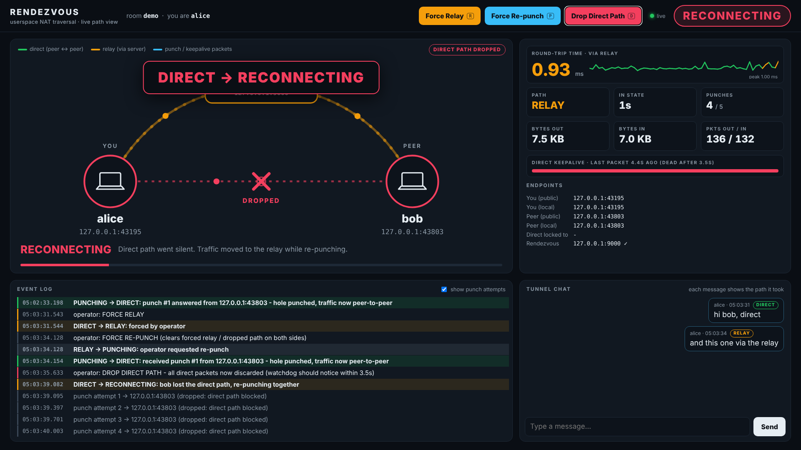

# Rendezvous: userspace NAT traversal with a live path view

Two peers connect over the internet through a NAT-traversing UDP tunnel. A
rendezvous server introduces them. They try **UDP hole punching** to get a
**direct** path, and fall back to **relaying through the server** if that fails.
Each peer serves a live dashboard that shows the connection state machine as it
runs, plus buttons that force path changes during a demo.

Pure userspace Python. No virtual adapter, no drivers, no admin rights.



```
rendezvous_server.py   UDP rendezvous + relay, HTTP status page (stdlib only)
peer.py                the peer: state machine, tunnel, dashboard server
dashboard.html         the live dashboard (plain HTML/CSS/JS, served by peer.py)
udp_test.py            tiny UDP echo/send tool to test passthrough (no netcat on Windows)
run_demo.bat           one-click, one-laptop demo on Windows
tools/natlab.sh        Linux/WSL lab with two real NAT routers, used for testing
```

## Install

Python 3.11 or newer.

```
py -m pip install -r requirements.txt
```

The rendezvous server uses only the standard library, so on a cloud box you can
copy that one file and run it without installing anything.

## Run it on one laptop (the guaranteed demo)

Double-click `run_demo.bat`, or open three terminals:

```
py rendezvous_server.py
py peer.py --name alice --http-port 8080
py peer.py --name bob   --http-port 8081
```

Open http://localhost:8080 and http://localhost:8081 side by side. Within a
second both peers go **DISCOVERING → PUNCHING → DIRECT**.

On loopback there's no NAT, so punching always succeeds. The demo controls
(also on the keyboard) drive the other transitions:

| Button | Key | What happens |
|---|---|---|
| **Force Relay** | R | Both peers pin traffic to the relay. DIRECT → RELAY right away. |
| **Force Re-punch** | P | Clears all overrides on both peers and punches again. → PUNCHING → DIRECT. |
| **Drop Direct Path** | D | Silently discards every direct packet, as if the path died. The state is *not* changed by hand: the keepalive watchdog notices the silence after 3.5 s (watch the keepalive meter fill up), goes **RECONNECTING**, re-punch fails, and it falls back to **RELAY**. |

A good demo order: let it reach DIRECT → send a chat message (tagged **DIRECT**)
→ **R** → send another (tagged **RELAY**) → **P** → **D** and narrate the
watchdog → **P** to recover.

To start in the "punching fails" situation, run one peer with
`--block-direct`. It punches for 5 s, falls back to RELAY, and retries direct
every 30 s (`--relay-retry`).

## Run it across two machines

1. Put `rendezvous_server.py` on a host with a public IP (any small cloud VM):
   ```
   python3 rendezvous_server.py            # UDP 9000, status page on TCP 9001
   ```
   Open **UDP 9000** inbound in the VM's firewall / security group (TCP 9001
   only if you want the status page).
2. On each machine, on **different networks** (e.g. home wifi and a phone hotspot):
   ```
   py peer.py --server <public-ip>:9000 --room <same-secret-code> --name alice
   py peer.py --server <public-ip>:9000 --room <same-secret-code> --name bob
   ```
3. When Windows Firewall asks about Python, allow it. If you block it, inbound
   punches get dropped and you will (correctly) end up on RELAY.

What to expect: most home routers are "cone" NATs, so you get DIRECT. Many
mobile carriers and corporate networks use symmetric NAT or CGNAT, so you get
RELAY. Both are valid outcomes, and the dashboard shows which one you got and why.

`http://<public-ip>:9001/` shows the rooms, each peer's public endpoint, and how
many packets the server relayed.

## Traffic through the tunnel

**Chat (built in).** Type in the dashboard's chat box, or straight into the
peer's terminal. Each message arrives on the other side tagged with the path it
actually took (DIRECT or RELAY).

**Passthrough (optional).** Carries a plain UDP app (a direct-IP game, a voice
tool, etc.) through the tunnel:

```
# machine B, where the "server" app runs on UDP 5555
py udp_test.py echo 5555
py peer.py --name bob --app-target 127.0.0.1:5555

# machine A: point the "client" app at 127.0.0.1:7000 instead of B's address
py peer.py --name alice --app-listen 7000
py udp_test.py send 127.0.0.1:7000
```

This is one flow, one direction of initiation, base64 inside JSON. It is fine
for a demo, but not tuned for throughput, and large datagrams may get fragmented.

## How NAT hole punching works here

**The problem.** Both peers sit behind NAT routers. Neither knows the other's
public address, and each router drops inbound packets it didn't ask for.

**1. Registration (DISCOVERING).** Each peer sends `register` to the server from
its single UDP socket. Its router creates a mapping
`192.168.1.10:46705 ⇄ 203.0.113.1:46705` and the server sees the packet arrive
from the *public* side of that mapping. The server replies with "this is your
public endpoint" and, once both are in the room, hands each peer the other's
public endpoint and LAN endpoint. Peers re-register every 2 s, which keeps the
mapping alive and lets the server notice when a peer disappears.

**2. Punching (PUNCHING).** Both peers send `punch` packets to each other's
public endpoint every 250 ms, *from the same socket* they registered with, so
they reuse the same mapping. A NAT lets a packet in only if it matches an
earlier outbound packet. Alice's first punch is dropped by Bob's router, since
Bob never talked to Alice. But sending it opened Alice's router towards Bob.
When Bob's punch arrives it matches that opening and gets through. Bob's own
punch did the same for his router, so Alice's next punch gets in too.
Whoever receives a punch answers with `punch_ack` to the exact address it came
from.

**3. DIRECT.** The first packet that arrives straight from the peer (punch,
ack, ping or pong) proves the path works. We lock onto the address it really
came from (the "peer-reflexive" address), which may differ from what the server
told us, e.g. when both peers are on the same LAN.

**4. RELAY.** If nothing gets through within 5 s, we wrap every message as
`{"t":"relay", inner:...}` and send it to the server, which forwards it. That
always works because both peers already have a live mapping to the server.

**5. Keepalives, RECONNECTING.** On the direct path, each peer pings every
second. The pongs give the RTT and also keep the NAT mappings from expiring.
If no direct packet arrives for 3.5 s, the peer moves traffic to the relay
straight away (no outage) and starts a new punch round (RECONNECTING). If that
succeeds it goes back to DIRECT; otherwise RELAY. While on RELAY it retries
direct every 30 s.

**Coordination.** Punching only works if both sides send at roughly the same
time. So whenever a peer starts a punch round on its own (watchdog, periodic
retry), it first sends a `punch_now` control message through the relay, and the
other peer joins in. Forced relay and re-punch are sent the same way, so both
dashboards always agree.

**When it fails.**
- *Symmetric NAT*: the router picks a new public port for each destination, so
  the port the server saw is useless to the peer. Predicting the port is out of
  scope, so we fall back to RELAY.
- *Port collisions on Linux-based routers*: if a punch reaches a router that
  accepts unsolicited input, the router can record that flow. The peer's own
  outbound punch then gets a different public port, so the punch misses. Most
  home routers drop unsolicited WAN input, which avoids this.
- *Firewalls* that block inbound UDP for the program.

### The protocol

JSON over UDP, one message per datagram. Every peer-to-peer message carries
`room` and `from`, and anything that doesn't match the room code and the known
peer id is dropped.

| message | path | meaning |
|---|---|---|
| `register` / `registered` | peer ⇄ server | join room / "your public endpoint is X" |
| `peer`, `peer_left` | server → peer | introduction / departure |
| `relay` / `relayed` | peer → server → peer | wrapped message for the relay path |
| `punch` / `punch_ack` | direct | open the NATs / confirm the path |
| `ping` / `pong` | active path | keepalive + RTT; the pong goes back on the path the ping came in on |
| `ctl` | relay (+ direct) | `punch_now`, `repunch`, `force_relay`; de-duplicated by id |
| `chat`, `app` | active path | demo traffic / passthrough datagram |

## Logs

Both programs print timestamped logs. Add `--verbose` / `-v` to see every
packet decision: punch sent, reply seen, keepalive, relay forwarding, packets
dropped and why. The dashboard's event log shows the same state events (punch
attempts can be hidden with the checkbox).

## Testing

- **Loopback**: all transitions, chat on both paths, passthrough on both paths,
  a peer quitting (the other goes back to DISCOVERING), `--block-direct`
  startup, periodic relay retry.
- **Real NAT** (`tools/natlab.sh`, Linux network namespaces, two MASQUERADE
  routers that drop unsolicited inbound):
  - both routers cone-like → DIRECT on the first punch, locked onto the peer's public endpoint;
  - `natlab.sh up --symmetric` (one router with `--random-fully`) → punching
    fails for real → RELAY;
  - drop direct / re-punch through both NATs.

## Peer options

```
--server HOST:PORT   rendezvous server (default 127.0.0.1:9000)
--room CODE          room code, both peers must match (default "demo")
--name NAME          display name
--http-port N        dashboard port (default 8080); --http-host 0.0.0.0 to show it on another device
--udp-port N         fix the tunnel's UDP port (default: any free port)
--punch-timeout S    punch this long before falling back (default 5)
--relay-retry S      retry direct every S seconds while on relay (default 30, 0 = never)
--block-direct       simulate an un-punchable NAT
--app-listen PORT / --app-target HOST:PORT   passthrough
--open               open the dashboard in a browser
--verbose            log every packet decision
```

## Deliberately out of scope

- **No virtual network adapter (TUN/TAP), no LAN broadcast forwarding.** A
  game's "Open to LAN" discovery uses broadcast/multicast on the local network
  segment. Making that appear across the internet needs a virtual adapter, which
  means a signed kernel driver on Windows. That is days of work and a demo risk.
  The tunnel carries an explicit UDP stream instead, which is enough to prove
  the overlay works.
- **No encryption.** The room code is the only access check. Anyone who can see
  the traffic can read it. A real version would add a key exchange (e.g. Noise).
- **No symmetric-NAT port prediction**, no IPv6, no TURN-style allocation
  auth, one peer pair per room, one passthrough flow.
